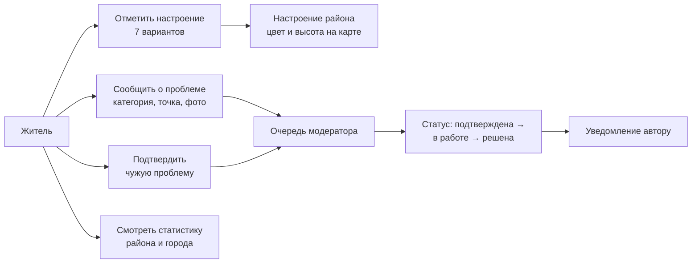

# 1. Что такое VibeRay

VibeRay — это 3D-карта города, на которой жители отмечают, как им живётся в их районе, и сообщают о конкретных
проблемах: мусор, ямы, тёмные дворы, пробки. Соседи подтверждают сообщения, модератор доводит их до решения, и
по карте сразу видно, где хорошо, а где нет.

Карта здесь главное. Районы на ней поднимаются тем выше, чем лучше в них настроение, на крышах стоят метки
проблем, любой район и любую метку можно открыть кликом.

## Города

Первый город — Костанай (Казахстан). Официального деления на районы у него нет, поэтому 14 районов собраны из
кварталов OpenStreetMap. Кроме Костаная на карте есть Кёльн (9 округов), Санкт-Петербург (18 районов),
Бристоль (34 округа) и Астана (6 районов); у них взяты официальные границы. Город переключается в панели карты. Подробнее —
в [разделе 6](06-cities-and-districts.md).

## Что можно делать на сайте

Отметить настроение можно одним из семи вариантов: отлично, хорошо, нормально, тревога, плохо, злость, очень
плохо. Из отметок жителей складывается настроение района, и от него зависят цвет и высота района на карте.

Сообщение о проблеме состоит из категории (их девять), описания, до трёх фото и точки на карте. Дальше
проблема проходит путь «новая → подтверждена → в работе → решена».

Статистику можно смотреть по району (карточка района) и по всему городу (дашборд за месяц, год или все годы).

Сайт работает на русском, казахском, английском и немецком, есть тёмная и светлая тема. Язык и тема
переключаются без перезагрузки страницы.

## Кто пользуется сайтом

Гость может смотреть карту, настроения, проблемы и статистику, но ничего отметить не может. Для этого нужно
зарегистрироваться. Другим пользователям видны только ник и аватар.

Житель (роль `user`) отмечает настроение, сообщает о проблемах, подтверждает чужие, получает уведомления и
настраивает профиль.

Модератор (роль `moderator`; `admin` видит то же самое) работает в отдельном интерфейсе на адресах
`/moderation/…`. Страниц жителя у него нет: после входа он сразу попадает в очередь проблем. Модератор меняет
статусы проблем, отклоняет спам и дубли и отвечает на обращения в поддержку.

## Страницы

| Страница | Что на ней |
|---|---|
| Главная | вход и регистрация, иллюстрация с девушкой; если прокрутить вниз, попадёшь на карту города |
| Карта города | слои «Районы», «Настроение» и «Проблемы»; слева фильтры, справа рейтинг районов |
| Карточка района | открывается кликом по району: настроение, из чего оно складывается, график за период |
| Статистика города | районы окрашены выбранным показателем, справа сводка, распределение настроений и график |
| Сообщение о проблеме | три шага: что случилось, где (точка на карте), описание и фото |
| Настройки | профиль (аватар и ник), мои сообщения, мой район, пароль, аккаунт |
| Модератор | очередь проблем, карта проблем, проблемные районы, обращения, настройки |
| О проекте | история идеи, которая разворачивается при прокрутке, и блок «Как это работает» |
| Поддержка | поиск по ответам, частые вопросы, форма обращения, статус сервиса |
| 404 | «Этот район ещё не нанесён на карту» и ссылки на карту, главную и поддержку |

На телефоне интерфейс свой, а не уменьшенная копия компьютерного: вместо панели вкладок меню, панели открываются
шторкой снизу, для действий есть круглая кнопка «+».

---

[Оглавление](README.md) · Дальше: [2. Как всё устроено](02-how-it-works.md)
