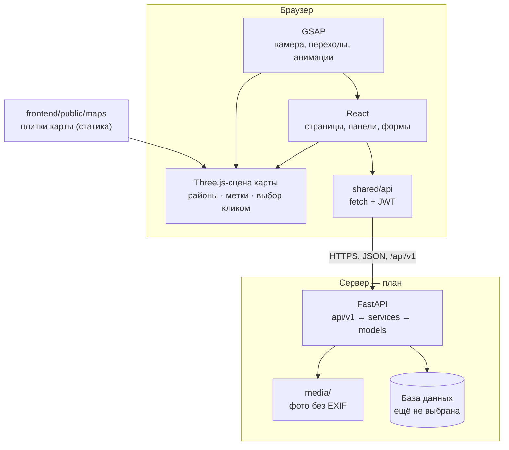
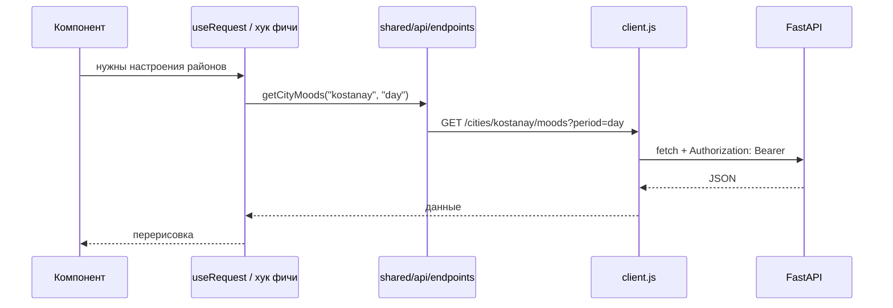
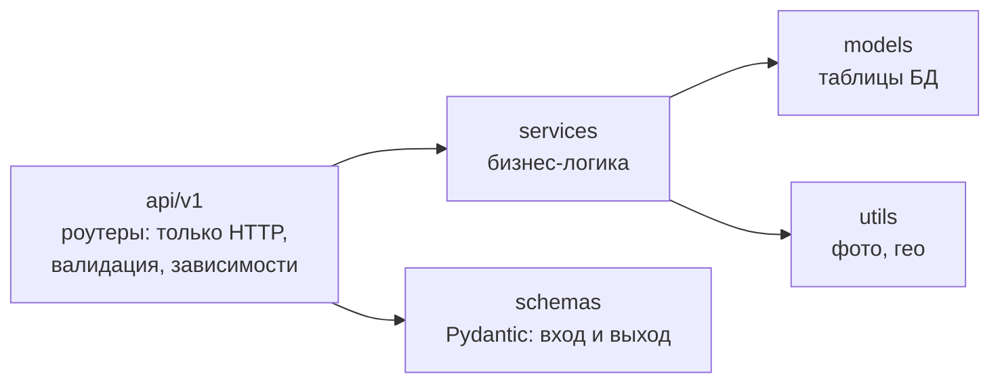

# 2. Как всё устроено

## Общая схема

VibeRay состоит из одностраничного приложения (SPA) в браузере и REST API на сервере. Сейчас готов
фронтенд, бэкенд в планах.

| Часть | Чем сделана | Состояние |
|---|---|---|
| Интерфейс | React 19, React Router 8, CSS Modules | работает |
| 3D-карта | Three.js | работает |
| Анимации | GSAP с плагинами ScrollTrigger и SplitText | работает |
| Сборка | Vite 8 | работает |
| REST API | FastAPI, Python 3.12+, Pydantic v2 | в планах |
| База данных | — | не выбрана, выбирает владелец проекта |
| Геоданные | OpenStreetMap и скрипты на Python | работают |

Карта рисуется на Three.js без картографических библиотек вроде Mapbox или Leaflet. Код написан на
JavaScript, стили — на CSS Modules без CSS-фреймворков.

## Как страница получает данные

Все запросы проходят через один клиент — `shared/api/client.js`. Компоненты сами в сеть не ходят: они
вызывают хук, хук — функцию запроса из `shared/api/endpoints/`, а клиент добавляет токен и разбирает ответ.

## Бэкенд

Бэкенд описан, но ещё не написан. Он будет устроен так:

Роутеры только принимают HTTP-запросы, логика находится в `services`. Наружу данные отдаются через
Pydantic-схемы. Все адреса начинаются с `/api/v1`. Список запросов — в [разделе 9](09-data-and-api.md).

---

Назад: [1. Что такое VibeRay](01-what-is-viberay.md) · [Оглавление](README.md) · Дальше: [3. Структура проекта](03-project-structure.md)
