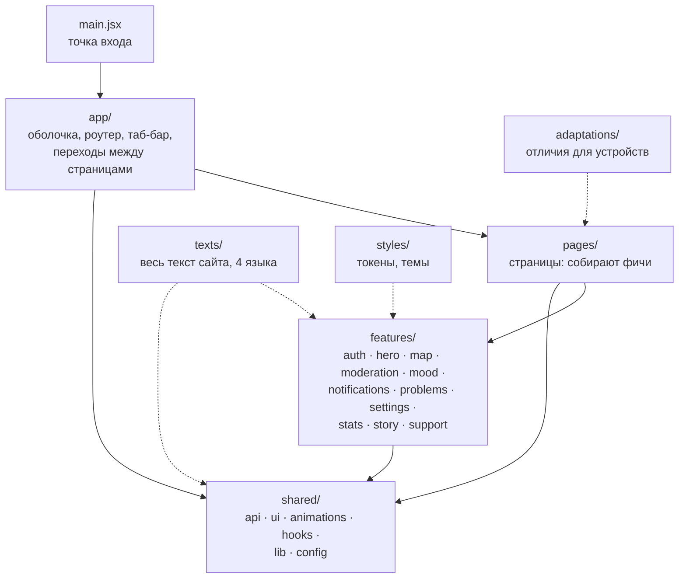
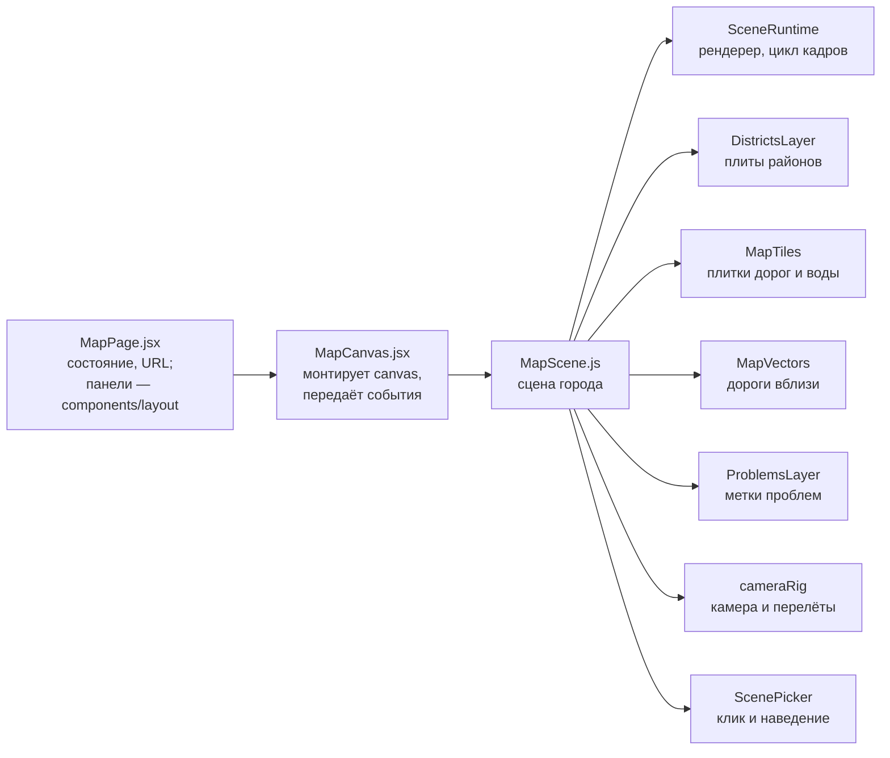

# 3. Структура проекта

## Верхний уровень

```
VibeRay/
├── README.md               # коротко о проекте и как запустить
├── ARCHITECTURE.md         # полная архитектура
├── CLAUDE.md, AGENTS.md    # правила для ИИ-ассистентов (только локально, в .gitignore)
├── docs/guide/             # эта документация (тексты и images/)
├── frontend/               # сайт: React, Three.js, GSAP
└── backend/                # FastAPI (в планах), данные городов, скрипты геоданных
```

## Слои фронтенда

Код фронтенда в `frontend/src/` разложен по слоям. Стрелка на схеме показывает, какой слой каким пользуется.
Общий слой `shared/` ничего не знает о модулях в `features/`, а модули обращаются друг к другу через свой
`index.js`.



| Папка | Что в ней | Пример |
|---|---|---|
| `app/` | оболочка, маршруты, таб-бар, переходы между страницами | `app/routing/router.jsx` |
| `pages/` | страницы, собранные из фич | `pages/MapPage/MapPage.jsx` |
| `features/` | модули по темам | `features/map/scene/MapScene.js` |
| `shared/api/` | клиент API и все запросы к серверу | `shared/api/endpoints/cities.js` |
| `shared/ui/` | общие элементы: кнопки, окна, иконки, графики | `shared/ui/icons/Icon.jsx` |
| `shared/animations/` | пресеты GSAP, переходы, смена языка и темы, отклик кнопок и переключателей | `shared/animations/core/presets.js` |
| `shared/lib/` | утилиты, внутри `i18n/`, `theme/`, `geo/` | `shared/lib/geo/geoProjection.js` |
| `shared/config/` | коды настроений, категорий, статусов | `shared/config/problemStatuses.js` |
| `texts/` | весь видимый текст на en, ru, kk, de | `texts/en/map.json` |
| `styles/` | токены и цвета тем | `styles/themes/dark.css` |
| `adaptations/` | масштаб интерфейса, телефон, планшет, одна колонка, ультраширокие и невысокие окна, сенсорные экраны | `adaptations/stacked/` |
| `demo-data/cities/` | копия данных городов для сайта | `demo-data/cities/kostanay/districts.geojson` |

## Как устроен модуль

Все модули и страницы устроены одинаково:

```
features/map/
├── index.js        # публичный API модуля, другие модули импортируют только его
├── components/     # компоненты: PascalCase.jsx и PascalCase.module.css рядом, по одному на файл;
│                   #   когда их больше ~8 — подпапки по смыслу (filters/, layout/, steps/)
├── hooks/          # useSomething.js
├── lib/            # чистые функции
├── model/          # контекст и провайдер, если у модуля есть состояние
├── scene/          # Three.js: обычные JS-классы без React
└── assets/         # картинки
```

## Кто отвечает за карту



React-компонент `MapCanvas` только монтирует холст и передаёт события. Всё, что относится к 3D, лежит в
`features/map/scene/` (подробнее в [разделе 5](05-map-3d.md)).

## Бэкенд

```
backend/
├── scripts/                  # геоданные: build_water, build_districts, build_streets, build_map_tiles,
│                             #   verify_city_data; cities.py — настройки городов, geodata/ — общий код
├── data/cities/<город>/      # city.json, districts.geojson, water.geojson, streets/, district_edits.geojson
├── .osm-cache/               # сырые ответы OpenStreetMap (в git не попадают)
├── requirements.txt          # зависимости API
├── requirements-dev.txt      # то же плюс тесты, линтер и shapely для скриптов
└── app/                      # в планах: main.py, core/, models/, schemas/, api/v1/, services/, utils/
```

Скрипты геоданных уже работают ([раздел 7](07-geodata-pipeline.md)), кода API пока нет.

## Где искать

| Что ищем | Где лежит |
|---|---|
| текст кнопки или подсказки | `frontend/src/texts/en/<раздел>.json` и такие же файлы в ru, kk, de |
| цвет | `frontend/src/styles/themes/dark.css` и `light.css` |
| отступы, радиусы, шрифты, длительности | `frontend/src/styles/tokens.css` |
| иконку | `frontend/src/shared/ui/icons/glyphs.jsx` |
| маршрут страницы | `frontend/src/app/routing/router.jsx` |
| коды статусов, категорий, настроений | `frontend/src/shared/config/` |
| запрос к API | `frontend/src/shared/api/endpoints/` |
| районы города | `backend/data/cities/<город>/districts.geojson` |
| стили для телефона | `frontend/src/adaptations/mobile/` |

---

Назад: [2. Как всё устроено](02-how-it-works.md) · [Оглавление](README.md) · Дальше: [4. Фронтенд](04-frontend.md)
