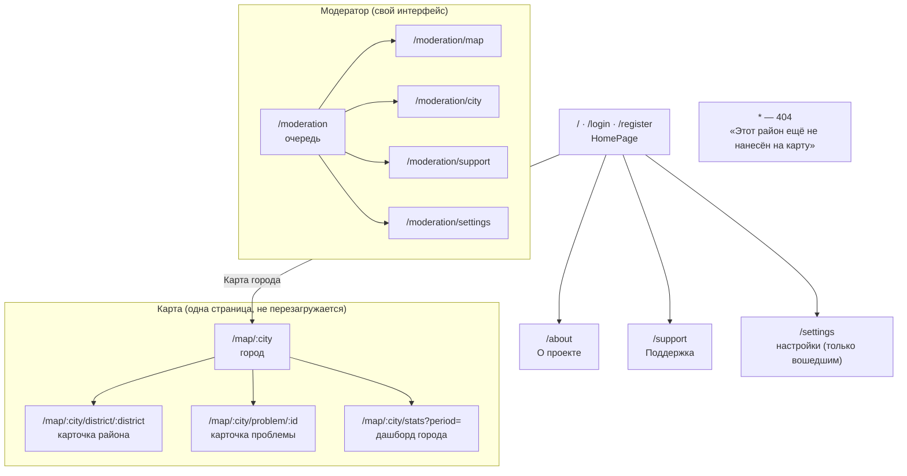
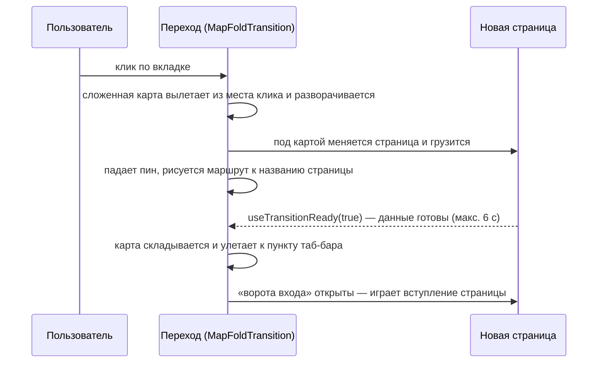
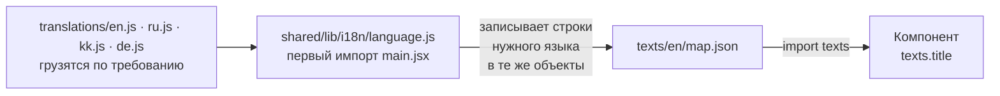
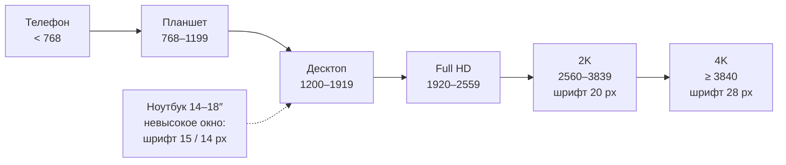

# 4. Фронтенд

## Страницы и адреса

| Адрес | Компонент | Что показывает |
|---|---|---|
| `/`, `/login`, `/register` | `HomePage` | главная; от адреса зависит, какая форма открыта: вход или регистрация |
| `/map/:city` | `MapPage` | 3D-карта, слои, рейтинг районов |
| `/map/:city/district/:district` | `MapPage` | то же с открытой карточкой района |
| `/map/:city/problem/:id` | `MapPage` | слой «Проблемы», камера подлетает к метке, открыта карточка проблемы |
| `/map/:city/stats?period=` | `MapPage` | дашборд города за месяц, год или все годы |
| `/about` | `AboutPage` | история идеи и блок «Как это работает» |
| `/support` | `SupportPage` | поиск ответов, частые вопросы, обращение, статус сервиса |
| `/settings` | `SettingsPage` | профиль, мои сообщения, мой район, пароль, аккаунт |
| `/moderation…` | `ModerationPage`, `ModerationMapPage` | интерфейс модератора |
| `*` | `NotFoundPage` | страница 404 |

Когда пользователь переходит между районами, проблемами и дашбордом, карта не создаётся заново: меняются только
панели, адрес и положение камеры. Выбранный район, проблема и период хранятся в адресе, поэтому прямые ссылки
и кнопка «назад» работают как ожидается.

## Переход между страницами

Между страницами играет анимация «бумажная карта» (`MapFoldTransition`):

Вступительные анимации страниц (рост районов, появление панелей) ждут момента, когда бумажная карта начинает
складываться (хук `usePageEntered`). Иначе они проигрывались бы под картой и их никто бы не увидел.

## Тексты и языки

Весь текст, который видит пользователь, лежит в `src/texts/<язык>/*.json`. Языков четыре: английский (основной),
русский, казахский и немецкий, ключи во всех файлах одинаковые. Строк текста в коде нет.

Компонент всегда импортирует английский файл, а `language.js` при запуске подменяет в этих же объектах строки
на нужный язык. Поэтому никакого «переводчика» в компонентах нет. Все четыре языка устроены одинаково: каждый
собран в отдельный файл на 13–16 КБ (в gzip) и скачивается, только когда он понадобился.

Язык меняется без перезагрузки: текст ненадолго размывается, строки подменяются, запросы к API повторяются на
новом языке, и текст проявляется обратно. Карта, прокрутка и введённые данные при этом остаются. У каждого
языка свой адрес: английский без префикса (`/map/kostanay`), остальные под `/ru/…`, `/kk/…`, `/de/…`. Даты и
числа показываются в формате выбранного языка, склонения («1 отметка, 5 отметок») тоже учитывают язык.

## Темы

Темы две: тёмная («лесная ночь», включена по умолчанию) и светлая («город днём», светло-зелёная).

Все цвета задаются CSS-переменными в `styles/themes/dark.css` и `light.css`, имена в обоих файлах одинаковые.
Отступы, радиусы, шрифты и длительности не зависят от темы и лежат в `styles/tokens.css`. 3D-сцена и canvas читают цвета через `cssVar()` и перекрашиваются при смене темы
(`subscribeTheme`). Сама смена — плавное растворение страницы, камера и открытые панели не сбрасываются.

| Что | Тёмная тема | Светлая тема |
|---|---|---|
| фон | `#0B110D` | `#E2EEDB` |
| поверхности | `#141D17` | `#E8F3E0` |
| рамки | `#24332A` | `#BCD6BB` |
| основной зелёный | `#2F7A4A`, при наведении `#3E9160` | тот же |
| текст | `#C8D3C4` / `#7C8C7E` | `#16301F` / `#466A52` |
| тревога | `#A8742E` | — |
| опасность | `#7A2E2A` | — |

Неоновых цветов, свечения цветом акцента и постобработки вроде bloom в проекте нет. Чистого белого в светлой
теме тоже нет, у светлых поверхностей всегда зелёный оттенок.

## Разные экраны

Всё, что отличается на разных устройствах, лежит в `src/adaptations/<уровень>/`. Элемент получает атрибут
`data-ui="…"`, а правило для него пишется в файле нужного уровня. Медиа-запросов по ширине внутри компонентов
нет.

Размеры задаются только в `rem`. На 2K и 4K увеличивается корневой шрифт, и интерфейс растёт целиком, не
разваливаясь.

Для телефона сделан отдельный интерфейс: меню вместо таб-бара, панели в шторках снизу, кнопки не меньше 44 px.
У анимаций, которые на пальце не работают (наведение, полёт по прокрутке), на телефоне своя замена. Телефон в
горизонтальном положении (например, 812 × 375) по ширине попадает в
планшеты, но навигация на нём всё равно телефонная. Качество 3D на слабых устройствах снижает
`renderQuality()` из `adaptations/core`.

## Анимации

| Где | Что двигается |
|---|---|
| таб-бар | капсула вылетает и растягивается, кнопки выпрыгивают из центра |
| главная | натекает подложка, карточка входа собирается из частей, у девушки появляются «мысли», прокрутка уводит в город |
| карта | перелёты камеры, рост районов, пульсация новых меток, появление панелей |
| графики | рисуется линия, растут столбики, числа досчитываются, строки таблиц переезжают при сортировке |
| язык и тема | размывается текст, растворяется страница |

Анимации сделаны на GSAP, общие пресеты лежат в `shared/animations/`. Если в системе включено «уменьшить
движение» (`prefers-reduced-motion`), анимации сокращаются или выключаются.

## Где хранится состояние

| Что | Где |
|---|---|
| кто вошёл | React Context (`features/auth/model`) |
| данные с сервера | `useRequest`: пока грузятся новые, на экране остаются старые |
| выбранный район, проблема, период | адрес страницы |
| тема, язык, город, скрытые панели, высота районов | `localStorage` браузера |

---

Назад: [3. Структура проекта](03-project-structure.md) · [Оглавление](README.md) · Дальше: [5. 3D-карта](05-map-3d.md)
