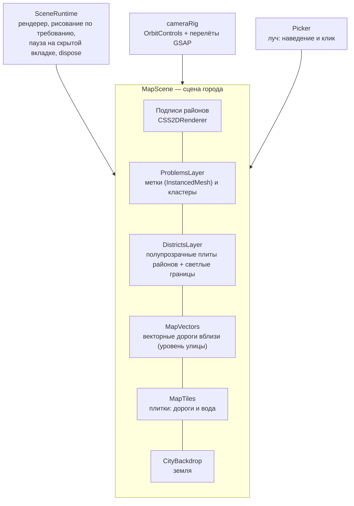
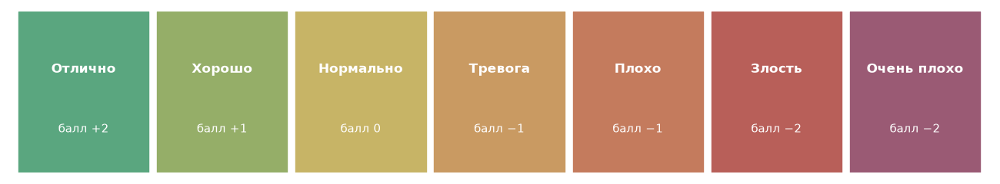
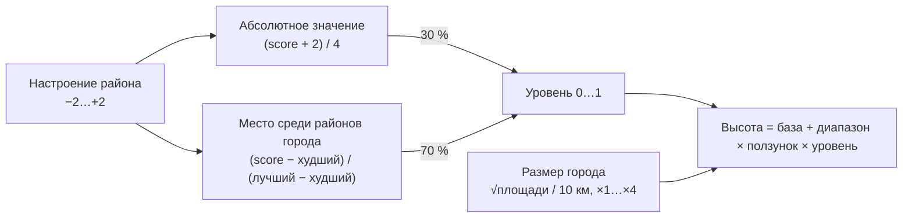
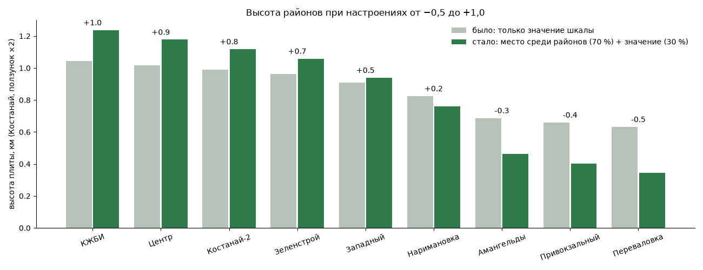
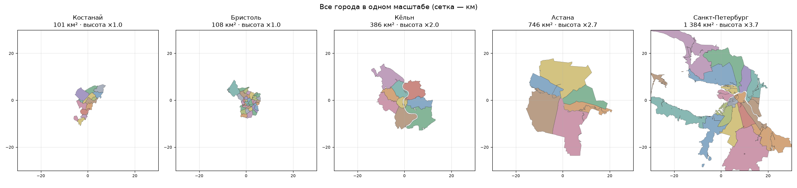
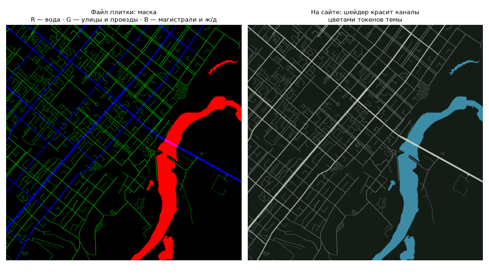
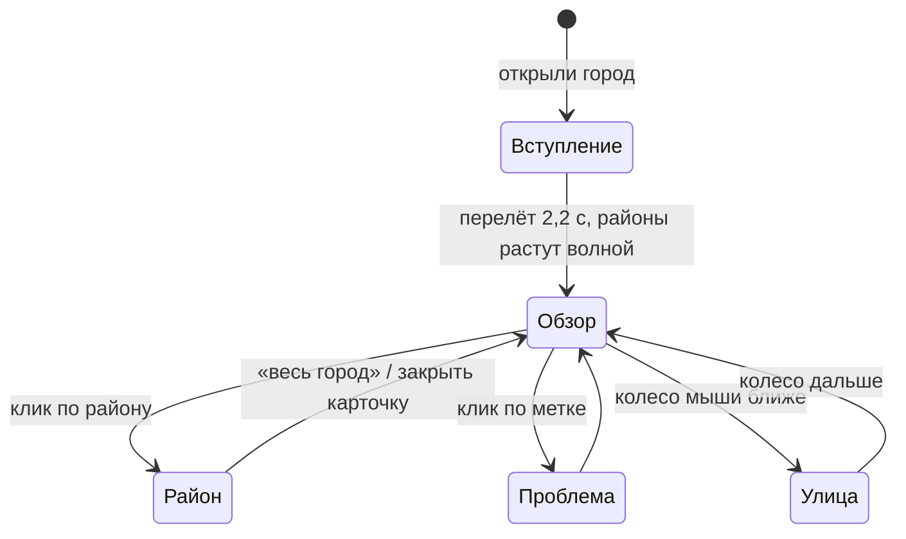

# 5. 3D-карта

Карта сделана на Three.js без Mapbox, Leaflet и сторонних тайловых сервисов. Внизу лежит земля, на ней плитки с
дорогами и водой. Над ними стоят полупрозрачные плиты районов, а на крышах районов — метки проблем.

## Из чего состоит сцена

| Слой | Файл | Что делает |
|---|---|---|
| земля | `CityBackdrop.js` | освещённая плоскость, к краям уходит в туман |
| плитки | `MapTiles.js` | картинки с дорогами и водой; чем ближе камера, тем подробнее плитки |
| дороги вблизи | `MapVectors.js` | на уровне улицы дороги рисуются линиями той же ширины, переход незаметен |
| районы | `DistrictsLayer.js` | выдавленные плиты; цвет зависит от слоя, высота — от настроения |
| метки | `ProblemsLayer.js`, `ClusterLabels.js` | стержень с головкой, цвет по статусу; близкие метки собираются в кластер |
| подписи | `MapScene.js` | названия районов; если подписи наезжают друг на друга, менее важная прячется |

Кадр перерисовывается только тогда, когда в нём что-то изменилось: двинулась камера, идёт анимация, курсор над
районом. Если ничего не происходит, карта не нагружает ни процессор, ни видеокарту.

## Цвет и высота районов

Цвет плиты зависит от слоя, выбранного в панели слева. На слое «Районы» у каждого района свой приглушённый цвет
(`--district-1…12`), и у соседей цвета не совпадают. На слое «Настроение» цвет берётся со шкалы настроения.
На дашборде статистики цвет показывает выбранный показатель: настроение или число проблем.

Высота показывает то же, что и цвет: чем лучше, тем выше. Настроения районов обычно мало отличаются друг от
друга (скажем, от −0,5 до +1 по шкале от −2 до +2), и если брать высоту прямо из значения, все плиты выходят
почти одинаковыми. Поэтому высота в основном зависит от места района среди остальных районов того же города, а
само значение шкалы даёт только 30 %.

В итоге лучший район города получается самым высоким, худший стоит почти у земли, а настоящее значение
настроения по-прежнему видно по цвету. Если в районе меньше пяти отметок, настроение не показывается
(порог приватности), и плита остаётся низкой. Общую высоту регулирует ползунок «Высота районов»: от 0 (плоская
карта) до ×4, по умолчанию ×2.

Ещё высота зависит от размера города. Над Петербургом камера висит намного дальше, чем над Костанаем, и те же
полкилометра высоты там почти не видны. Поэтому множитель высоты считается так: корень из площади районов
делим на 10 км, результат ограничиваем от 1 до 4.

| Город | Площадь районов | Множитель высоты |
|---|---|---|
| Костанай | 101 км² | 1,0 |
| Бристоль | 108 км² | 1,0 |
| Кёльн | 386 км² | 2,0 |
| Астана | 746 км² | 2,7 |
| Санкт-Петербург | 1 384 км² | 3,7 |

Плиты полупрозрачные (непрозрачность около 0,5), дороги лежат под ними на земле и просвечивают. Поэтому сеть
дорог не обрывается на границах районов разной высоты.

## Плитки дорог и воды

Схему дорог браузер не скачивает: у одного Петербурга она весит 41 МБ. Вместо неё используются готовые
картинки-плитки из `frontend/public/maps/<город>/`, которые заранее рисует скрипт `build_map_tiles.py`.

Плитка хранит не цвета, а маску. В красном канале записана вода, в зелёном — улицы и проезды, в синем —
магистрали и железная дорога. Цвет каждому каналу назначает шейдер, беря его из переменных темы, поэтому одни и
те же плитки подходят и тёмной, и светлой теме.

Плитки собраны в пирамиду. На самом подробном уровне один пиксель — 3 метра, на каждом следующем вдвое грубее.
Плитка 512 × 512 px в формате WebP без потерь. Какой уровень показывать, решает расстояние до камеры. Пока
подробные плитки не загрузились, видна грубая, так что дыр на карте не бывает.

Когда камера опускается к улицам и самая подробная плитка растягивается на экране больше чем в полтора раза,
дороги начинают рисоваться линиями (`maps/<город>/vector/*.json`). Плиты районов при подлёте, от 5 до 1,2 км
до точки взгляда, постепенно ложатся на землю и не закрывают улицы. К краю города плитки плавно гаснут
(`edgeFade.js`). Плитки кэширует сервис-воркер; после пересборки он узнаёт об этом по версии в `tiles.json` и
сбрасывает старый кэш.

## Камера

В режиме обзора в кадр помещается весь город. Границы кадра считаются по плитам районов, а не по улицам, иначе
дороги за городом отодвинули бы камеру. На телефоне центр кадра поднимается, чтобы город не прятался под
шторкой. Туман и дальность камеры растут вместе с размером города. Ближе всего камера подлетает на 0,6 км, в
кадре тогда около 400 метров улицы.

## Метки проблем

Метки нарисованы двумя `InstancedMesh` (стержни и головки), поэтому тысячи меток рисуются за один вызов. Цвет
метки зависит от статуса: новая, подтверждена, в работе, решена. Новые метки пульсируют. Если метки на экране
ближе 70 px друг к другу, они собираются в кластер: значок с числом и кольцом долей статусов. Клик по кластеру
приближает камеру.

## Производительность и стиль

Сцена загружается отдельным файлом, только когда открыта карта. Плотность пикселей ограничена двумя, а на
скрытой вкладке карта не рисуется вовсе. Свечения и постобработки (bloom) в сцене нет: объём районов передаётся
обычным светом и матовыми материалами.

---

Назад: [4. Фронтенд](04-frontend.md) · [Оглавление](README.md) · Дальше: [6. Города и районы](06-cities-and-districts.md)
