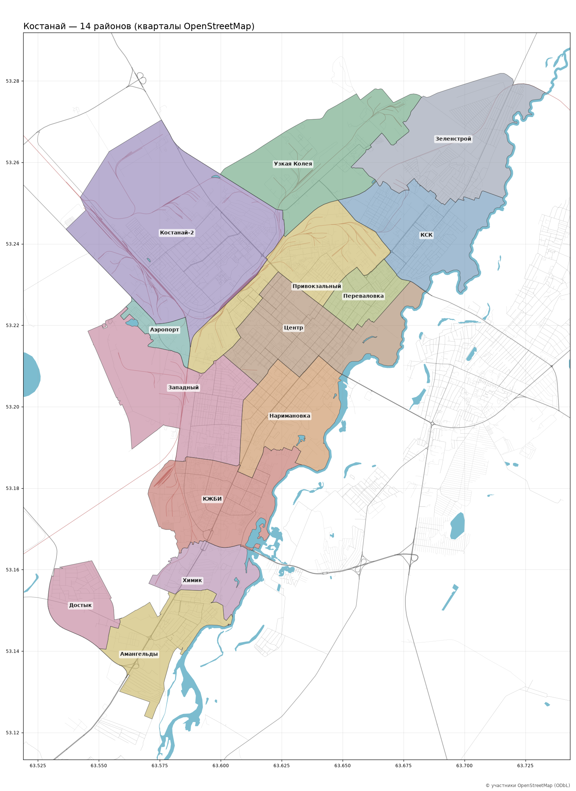
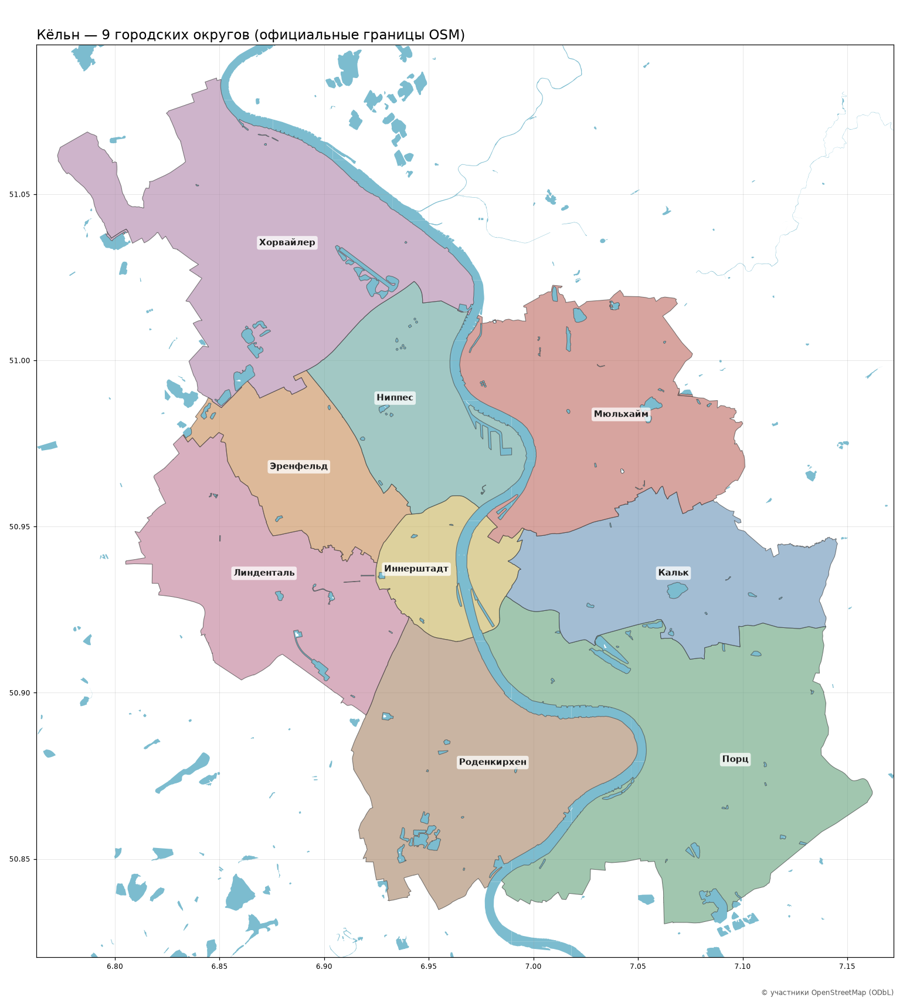
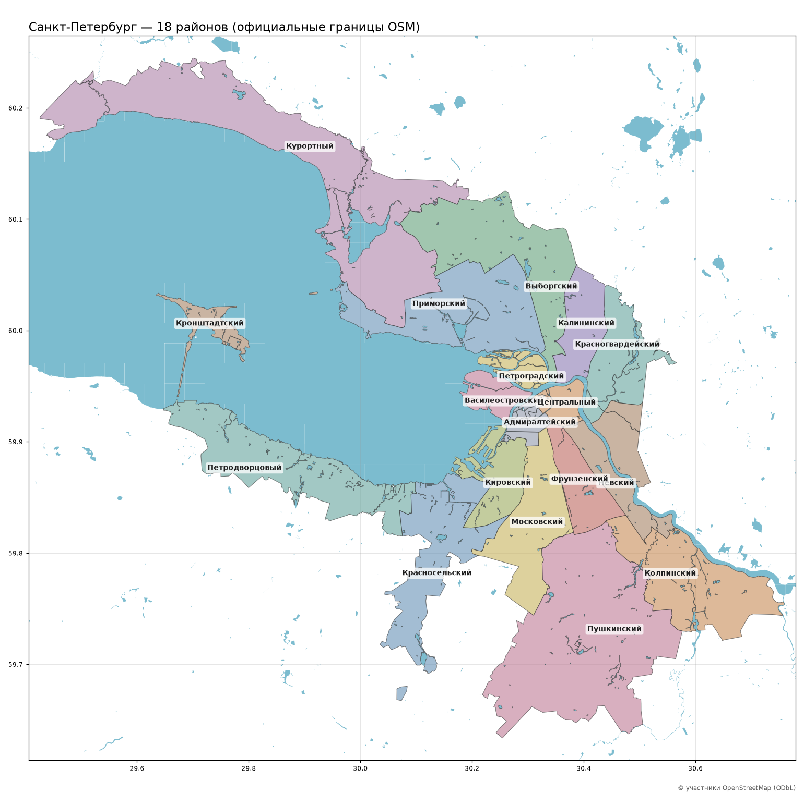
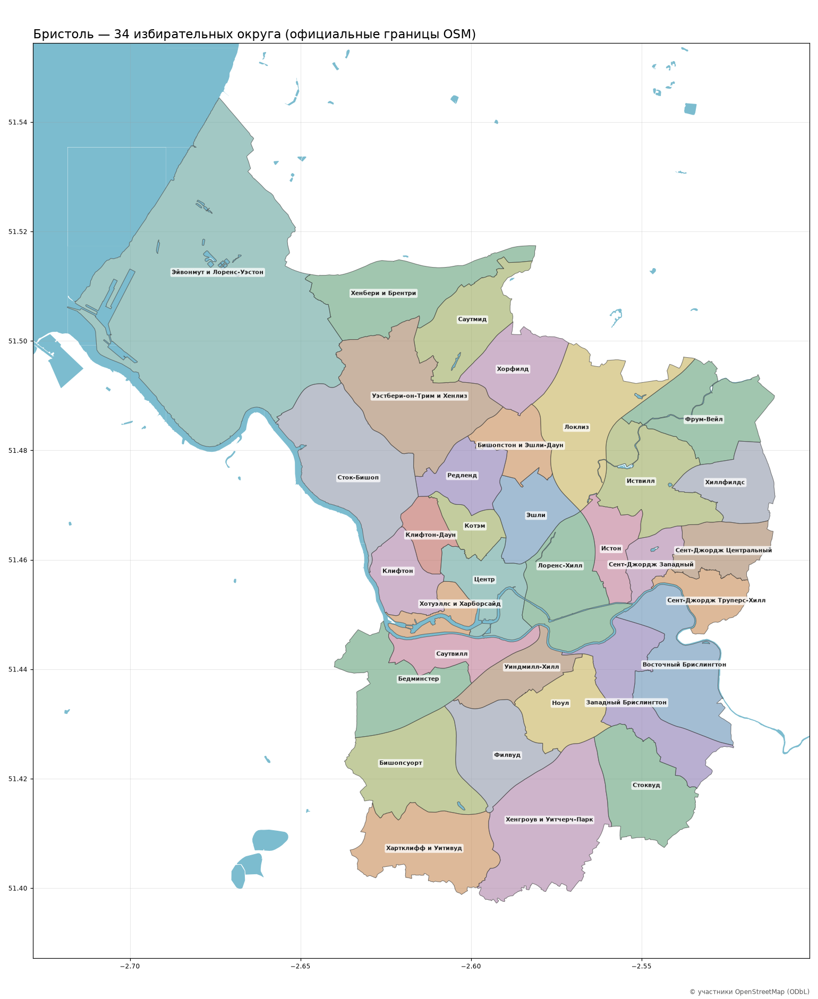
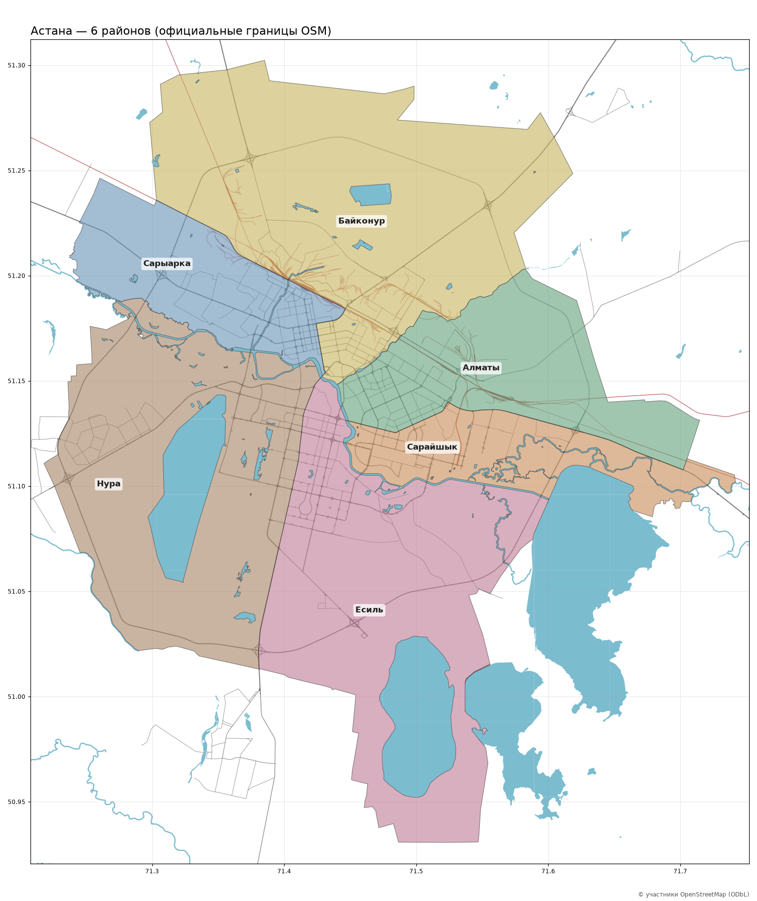

# 6. Города и районы

На карте пять городов. Главный из них Костанай: с ним работают главная страница и история «О проекте».
Остальные города открываются переключателем «Город» в панели карты. Границы районов,
улицы и вода во всех городах взяты из OpenStreetMap. С 2ГИС и Google Картами карту только сверяли на глаз,
геометрия оттуда не используется.

| Город | slug | Районов | Площадь | Откуда границы |
|---|---|---|---|---|
| Костанай | `kostanay` | 14 | 101 км² | собраны из кварталов OSM |
| Кёльн | `cologne` | 9 | 386 км² | `boundary=administrative`, `admin_level=9` |
| Санкт-Петербург | `saint-petersburg` | 18 | 1 384 км² | `admin_level=5` |
| Бристоль | `bristol` | 34 | 108 км² | `boundary=political`, `political_division=ward` |
| Астана | `astana` | 6 | 746 км² | `admin_level=6` |

Данные OpenStreetMap распространяются по лицензии ODbL, поэтому на карте всегда есть подпись
«© участники OpenStreetMap».

## Костанай



Официального деления на районы у Костаная нет ни в самом городе, ни в OpenStreetMap. Поэтому мы взяли районы так,
как их называют жители, а границы провели только по линиям OSM. Город разрезан на кварталы улицами, железной
дорогой, берегом Тобола и контурами участков, и каждый квартал целиком отдан одному району (как это делается,
описано в [разделе 7](07-geodata-pipeline.md#районы-костаная)). Пригороды (Тобыл, Заречное, Мичуринское,
Алтынсарино) на карту не входят.

| Район | slug | км² | Что входит |
|---|---|---|---|
| Костанай-2 | `kostanay-2` | 19,8 | всё за железной дорогой от центра: посёлок «Қостанай-2» и массив Северо-Запад |
| Зеленстрой | `zelenstroy` | 10,2 | северо-восток: «Тепличный» и кварталы севернее КСК до Тобола |
| Западный | `zapadny` | 9,9 | «Западный», «Әскери қалашық», «ЖК Весна» |
| Узкая Колея | `uzkaya-koleya` | 9,4 | «Узкая Колея» |
| Центр | `center` | 8,0 | старый город от вокзального квартала до Набережной Тобола, на север до пр. Назарбаева |
| Привокзальный | `vokzal` | 7,6 | полоса вдоль железной дороги: станция, вокзальный квартал, промзона, северный ж/д-парк |
| КЖБИ | `kzhbi` | 7,3 | «КЖБИ», 1–9 микрорайоны, «Наурыз» |
| КСК | `ksk` | 7,2 | «КСК», Киевский и Корейский посёлки, 2-й и 4-й микрорайоны |
| Наримановка | `narimanovka` | 6,1 | «Нəрымановка», «Жаңа Қала», «Жол Полициясы», Шахринка |
| Амангельды | `amangeldy` | 5,3 | посёлок Амангельды (бывший Красный Партизан) и застройка до Тобола |
| Химик | `khimik` | 3,3 | «Химик», «Геофизик», «Сай Қаласы» |
| Достык | `dostyk` | 3,1 | «Достық» и прилегающие кварталы |
| Переваловка | `perevalovka` | 2,4 | «Переваловка» |
| Аэропорт | `aeroport` | 1,3 | посёлок и привокзальная зона аэропорта, без лётного поля |

## Кёльн



В Кёльне взяты девять городских округов (Stadtbezirke) в официальных границах OSM, точка в точку: без
пригородов, без обрезки по застройке и без сглаживания. Из округов вырезана только вода (Рейн, гавани, озёра).

| Округ | slug | Суша, км² |
|---|---|---|
| Порц (Porz) | `porz` | 74,7 |
| Хорвайлер (Chorweiler) | `chorweiler` | 63,4 |
| Роденкирхен (Rodenkirchen) | `rodenkirchen` | 50,8 |
| Мюльхайм (Mülheim) | `muelheim` | 49,8 |
| Линденталь (Lindenthal) | `lindenthal` | 41,3 |
| Кальк (Kalk) | `kalk` | 37,8 |
| Ниппес (Nippes) | `nippes` | 29,7 |
| Эренфельд (Ehrenfeld) | `ehrenfeld` | 23,8 |
| Иннерштадт (Innenstadt) | `innenstadt` | 14,6 |

От официальных границ отличается одно место. На границе Эренфельда и Ниппеса у путей главного вокзала был
залив с зубцами; по просьбе владельца проекта его закрыли прямой линией и отдали Эренфельду (3,6 га).

## Санкт-Петербург



Восемнадцать административных районов в официальных границах. Курортный доходит до Смолячкова, Пушкинский и
Колпинский взяты вместе с полями, Кронштадт — с фортами. Берег Финского залива проведён по береговой линии OSM.

| Район | slug | Суша, км² |
|---|---|---|
| Курортный | `kurortny` | 257,8 |
| Пушкинский | `pushkinsky` | 235,5 |
| Выборгский | `vyborgsky` | 112,7 |
| Петродворцовый | `petrodvortsovy` | 108,1 |
| Приморский | `primorsky` | 106,6 |
| Колпинский | `kolpinsky` | 97,2 |
| Красносельский | `krasnoselsky` | 88,5 |
| Московский | `moskovsky` | 73,1 |
| Невский | `nevsky` | 56,6 |
| Красногвардейский | `krasnogvardeysky` | 53,5 |
| Калининский | `kalininsky` | 39,4 |
| Кировский | `kirovsky` | 39,2 |
| Фрунзенский | `frunzensky` | 36,9 |
| Василеостровский | `vasileostrovsky` | 19,4 |
| Кронштадтский | `kronshtadtsky` | 16,1 |
| Петроградский | `petrogradsky` | 15,3 |
| Центральный | `tsentralny` | 15,3 |
| Адмиралтейский | `admiralteysky` | 12,3 |

## Бристоль



Тридцать четыре избирательных округа (wards) по делению 2016 года. Округ Avonmouth & Lawrence Weston официально
уходит в эстуарий Северна на 30 км (145 км², из которых суши только 20 км²); на карте от него осталась суша.

<details>
<summary>Все 34 округа</summary>

| Округ | slug | км² |
|---|---|---|
| Эйвонмут и Лоренс-Уэстон | `avonmouth` | 19,8 |
| Хенгроув и Уитчерч-Парк | `hengrove` | 5,5 |
| Уэстбери-он-Трим и Хенлиз | `westbury-on-trym` | 5,3 |
| Сток-Бишоп | `stoke-bishop` | 5,2 |
| Локлиз | `lockleaze` | 4,3 |
| Хенбери и Брентри | `henbury` | 3,9 |
| Бишопсуорт | `bishopsworth` | 3,9 |
| Восточный Брислингтон | `brislington-east` | 3,7 |
| Хартклифф и Уитивуд | `hartcliffe` | 3,6 |
| Иствилл | `eastville` | 3,5 |
| Лоренс-Хилл | `lawrence-hill` | 3,5 |
| Фрум-Вейл | `frome-vale` | 3,5 |
| Западный Брислингтон | `brislington-west` | 3,3 |
| Стоквуд | `stockwood` | 3,2 |
| Бедминстер | `bedminster` | 3,1 |
| Филвуд | `filwood` | 2,8 |
| Саутмид | `southmead` | 2,7 |
| Хорфилд | `horfield` | 2,3 |
| Ноул | `knowle` | 2,3 |
| Центр | `bristol-central` | 2,1 |
| Хиллфилдс | `hillfields` | 2,0 |
| Эшли | `ashley` | 2,0 |
| Сент-Джордж Центральный | `st-george-central` | 1,8 |
| Редленд | `redland` | 1,7 |
| Уиндмилл-Хилл | `windmill-hill` | 1,7 |
| Клифтон | `clifton` | 1,7 |
| Саутвилл | `southville` | 1,6 |
| Бишопстон и Эшли-Даун | `bishopston` | 1,5 |
| Истон | `easton` | 1,5 |
| Сент-Джордж Труперс-Хилл | `st-george-troopers-hill` | 1,3 |
| Сент-Джордж Западный | `st-george-west` | 1,0 |
| Клифтон-Даун | `clifton-down` | 1,0 |
| Котэм | `cotham` | 1,0 |
| Хотуэллс и Харборсайд | `hotwells` | 0,9 |

</details>

## Астана



Шесть административных районов в официальных границах OSM. Районы взяты вместе со степью внутри городской черты,
вырезана вода: Есиль с протоками, озёра и пруды. Два места поправлены по разметке владельца проекта. Северная
граница Байконура в OSM шла зубцами, провалы между ними закрыты прямыми по вершинам OSM, а отдельный участок
Байконура на северо-западе присоединён к району. Официальные участки Байконура на северо-востоке и района Алматы
на востоке лежат далеко за городом, на карту они не входят. Сарайшык — самый новый район Астаны, в OSM он уже
есть.

| Район | slug | Суша, км² |
|---|---|---|
| Байконур (Байқоңыр) | `baikonur` | 208,3 |
| Есиль (Есіл) | `esil` | 165,9 |
| Нура (Нұра) | `nura` | 163,5 |
| Алматы | `almaty-district` | 88,3 |
| Сарыарка (Сарыарқа) | `saryarka` | 66,8 |
| Сарайшык (Сарайшық) | `saraishyk` | 53,2 |

slug района Алматы — `almaty-district`, чтобы его не путать с городом Алматы.

## Названия и цвета

Названия районов хранятся в `districts.geojson`. В поле `name` лежит русское название, в `name_en` английское,
а где есть, ещё `name_kk` и `name_de`. Русские и казахские названия даны в принятой транслитерации
(«Иннерштадт», «Клифтон»), английские и немецкие оставлены родными («Mülheim»). Если немецкого названия нет,
показывается английское, если нет казахского — русское.

`slug` района уникален среди всех городов; на сайте он же служит идентификатором района.

Поле `palette` (от 1 до 12) задаёт цвет района `--district-N`. Соседние районы, включая соседей через реку
(ближе 150 м), получают разные цвета. При пересборке район сохраняет прежний цвет, если тот не совпал с цветом
соседа.

## Файлы города

```
backend/data/cities/<город>/
├── city.json                 # название на четырёх языках, центр, рамка, источник данных
├── districts.geojson         # районы: MultiPolygon, slug, name*, palette
├── water.geojson             # реки, озёра, море
├── streets/<район>.geojson   # схема дорог по районам и _outside.geojson; нужна только для плиток
└── district_edits.geojson    # что поправила автоматическая чистка контуров
```

Копии `city.json`, `districts.geojson` и `water.geojson` лежат во `frontend/src/demo-data/cities/<город>/` и
должны совпадать с оригиналами байт в байт. Схемы дорог во фронтенде нет, карта обходится плитками.

---

Назад: [5. 3D-карта](05-map-3d.md) · [Оглавление](README.md) · Дальше: [7. Геоданные](07-geodata-pipeline.md)
