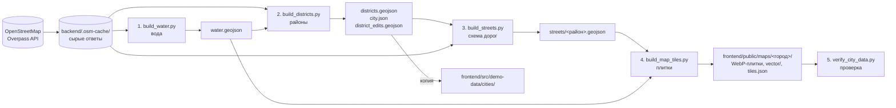
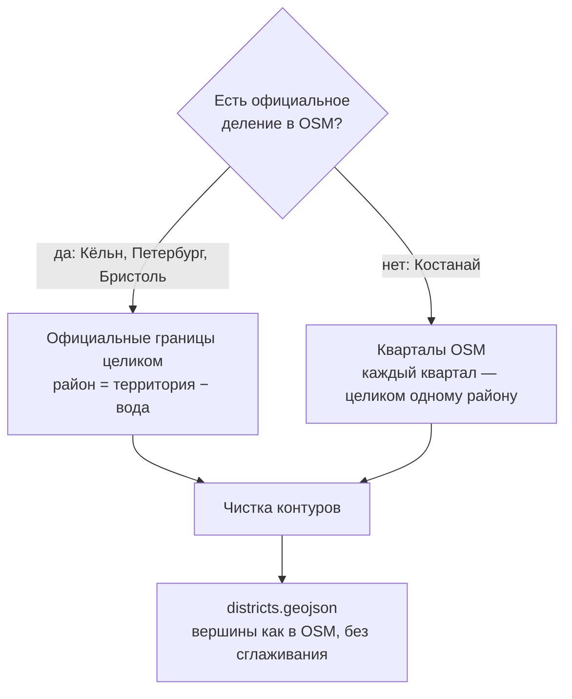
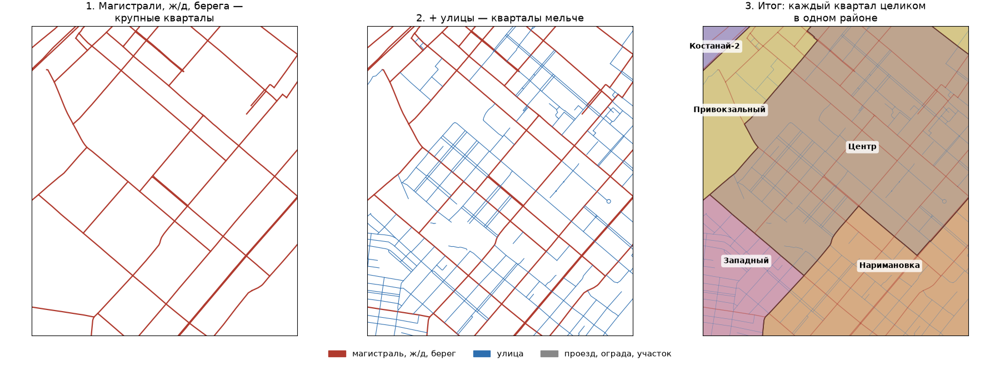
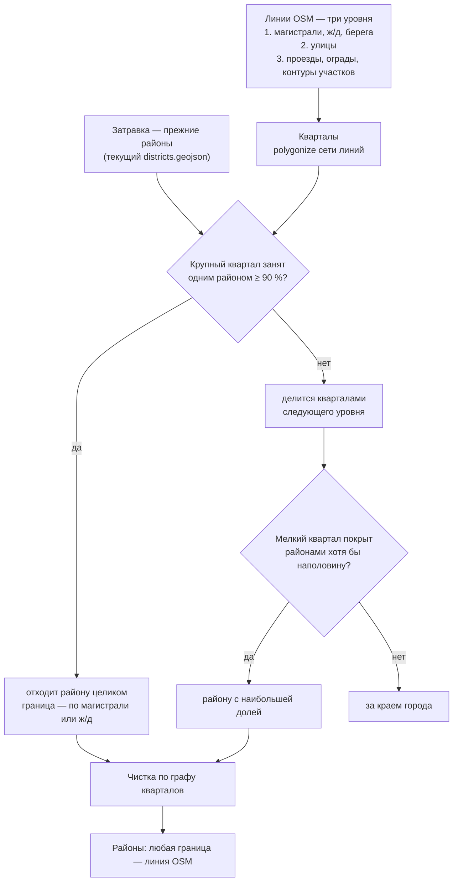

# 7. Геоданные

Районы, воду, улицы и плитки карты никто не рисует руками. Их собирают скрипты из данных OpenStreetMap. В этом
разделе описан путь от сырых данных до карты на экране.

## Порядок сборки

| Шаг | Команда | Результат |
|---|---|---|
| 1 | `python backend/scripts/build_water.py <город>` | вода города (нужна новому городу; у готовых уже собрана) |
| 2 | `python backend/scripts/build_districts.py <город>` | районы, центр и рамка города, список правок чистки |
| 3 | `python backend/scripts/build_streets.py <город>` | схема дорог по районам |
| 4 | `python backend/scripts/build_map_tiles.py <город>` или `--all` | плитки карты и векторные куски дорог |
| 5 | `python backend/scripts/verify_city_data.py <город>` или `--all` | таблица проверок и итог «ПРИНЯТО» |

Шаги идут именно в таком порядке: районы вычитают воду, плитки рисуются от центра города, а центр считается по
районам. Поэтому после изменения воды пересобирается всё, а после изменения районов — улицы и плитки.

Какие районы есть у города и откуда они берутся в OSM, записано в одном месте — `backend/scripts/cities.py`.
Общий код скриптов (запросы к OSM, перевод градусов в метры, запись файлов) лежит рядом, в папке `geodata/`.
Скриптам нужны `shapely` и Pillow, обе ставятся командой `pip install -r backend/requirements-dev.txt`. Ответы
Overpass сохраняются в `backend/.osm-cache/` (в git эта папка не попадает), так что повторная сборка обходится
без интернета и даёт точно такие же файлы.

## Откуда берутся районы

### Города с официальными границами

Для Кёльна, Петербурга и Бристоля скрипт скачивает из Overpass отношения районов и собирает из их линий
полигоны. Если кольцо границы в OSM разорвано, разрыв до 200 м сшивается.

Затем границы районов и контур воды совмещаются на сетке координат OSM (шаг 1e-7°, это примерно сантиметр), и
район получается как официальная территория минус вода. Вершины остаются такими же, как в OSM, а у соседних
районов общая граница проходит через одни и те же точки.

Клочки суши меньше 2 га (островки, пирсы, щепки у берега) в районы не входят. Острова крупнее остаются
отдельными частями района, например форты Кронштадта и острова Невы.

Иногда официальную границу поправляют вручную, по разметке владельца проекта, и всегда прямыми между
вершинами OSM. Таких правок в `cities.py` три вида:

- `bays` — залив соседнего района: всё, что между прямой и границей района, отходит району. Так закрыты зубцы
  Эренфельда у Ниппеса в Кёльне.
- `fills` — провал между зубцами границы: земля за городом между линией и районом отходит району. Так
  выровнена северная граница Байконура в Астане.
- `drops` — отдельный кусок района далеко за городом на карту не идёт. Так убраны эксклавы Байконура и района
  Алматы.

### Районы Костаная

У Костаная официальных районов нет, поэтому город режется на кварталы линиями OSM. Прежние районы (их называют
затравкой) подсказывают только, какому району отдать квартал; сами старые границы в результат не попадают.

После раздачи кварталов скрипт подчищает мелочи:

| Случай | Что происходит |
|---|---|
| пустой квартал до 30 га, на 90 % окружённый районами и водой | отходит району, с которым у него самая длинная общая граница |
| квартал на краю, который касается города меньше чем 15 % своей границы | убирается |
| квартал до 3 га, который на 60 % граничит с чужим районом | отходит этому району |
| кусок района, прижатый к соседу | отходит соседу |
| кусок района на отшибе меньше 2 га | убирается |

Внешний край города проходит по последней линии OSM вокруг застройки, поэтому лётное поле и голая степь в районы
не попадают. Вода вырезается. Вершины не упрощаются и не сглаживаются ни в скрипте, ни на сайте.

В нескольких местах граница проходит там, где в OSM нет ни одной линии: так сделано с выемкой на севере
Костаная-2 и с узкими «пальцами» Достыка и Химика. Для них в `cities.py` задана короткая прямая между
узлами OSM (`closures`). Она режет кварталы так же, как магистраль.

## Чистка контуров

Официальная граница района и берег — это разные линии, и там, где они расходятся, у района появляется мусор:
полоска на чужом берегу, пирс, пятно пляжа. После сборки скрипт чистит контуры во всех городах и записывает
каждую правку в `district_edits.geojson`.

| Правка | Что делает | Порог |
|---|---|---|
| `far_bank` | убирает кусок района на чужом берегу | меньше 10 га |
| `cut` | срезает тонкую полосу у воды или на краю (пирс, кромку) | уже 24 м |
| `move` | отдаёт соседу тонкую полосу, которая заходит внутрь его района | уже 24 м |
| `fill` | отдаёт сушу, запертую между районами и водой (пляж, намыв), району с самой длинной общей границей | меньше 100 га |
| `slit` | заполняет узкую длинную щель внутри города | уже 120 м |

У Костаная вдобавок срезаются выступы уже 80 м, которые торчат в пустую землю (`bump_m`), а более широкие
выступы — по отмеченным точкам (`bumps`). Официальные линии между районами чистка не
двигает.

## Вода и улицы

Вода (`water.geojson`, скрипт `build_water.py`) берётся из OSM площадями: реки, озёра и море (Финский залив,
эстуарий Северна) по береговой линии. Если у реки в OSM есть только осевая линия, русло рисуется лентой шириной
64 м. Водоёмы меньше 0,3 га отбрасываются, а очень большие режутся сеткой 4 км, иначе браузер ошибается, когда
разбивает огромный полигон моря на треугольники. Районы вычитают воду, так что берег района и берег на карте
совпадают.

Улицы (`streets/`) делятся на классы `major`, `secondary`, `tertiary`, `local`, `service` и `rail`. Каждая линия
разрезана по районам и лежит в файле своего района; всё, что за пределами районов, лежит в
`_outside.geojson`. Названий и адресов в схеме нет, только сами дороги. Большой город загружается из Overpass
частями (`--tiles N`: Бристоль 2, Кёльн 4, Петербург 6). Без интернета можно собрать из сохранённого ответа
(`--osm файл.json`), сохранить ответ — `--save-osm`.

## Плитки

`build_map_tiles.py` рисует из улиц и воды пирамиду плиток (как они показываются на карте, описано в
[разделе 5](05-map-3d.md#плитки-дорог-и-воды)):

Плитка — 512 px, WebP без потерь. Пустые плитки и плитки за контуром города не сохраняются. В `tiles.json`
лежит список плиток и версия (хеш содержимого), по которой сервис-воркер понимает, что кэш устарел.

## Проверка

`verify_city_data.py` сравнивает готовые файлы с теми же ответами OpenStreetMap, из которых они собраны, и
печатает таблицу: что проверено, что получилось и какой порог. Если хоть одна строка не прошла, итог —
«НЕ ПРИНЯТО».

| Код | Что проверяется |
|---|---|
| D1 | районов столько, сколько в `cities.py`, и у всех есть названия |
| D2 | геометрия правильная: замкнутые кольца, без самопересечений, всё в рамке города |
| D3 | районы не налезают друг на друга и за границу города, вся суша города разобрана по районам |
| D4 | граница района через каждые 10 м лежит на линии OSM (или на берегу, ручной прямой, правке чистки) |
| D5 | у соседних районов общая граница проходит через одни и те же вершины |
| W1 | районы не заходят на воду, берега совпадают с берегами OSM |
| R1–R3 | каждая вершина схемы дорог — точка OSM, дороги OSM не потеряны, дорога лежит в своём районе |
| T1 | дороги видны на плитках и в векторных кусках, центр плиток — центр города |
| C1 | копия данных во фронтенде не отличается от данных бэкенда |

Мелкие правки чистки контуров (`district_edits.geojson`) ошибкой не считаются: проверка знает, где граница
специально отошла от линии OSM.

---

Назад: [6. Города и районы](06-cities-and-districts.md) · [Оглавление](README.md) · Дальше: [8. Настроение, проблемы, статистика](08-mood-problems-stats.md)
