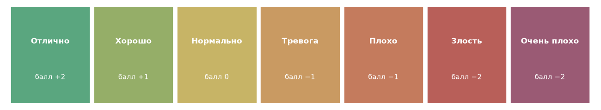
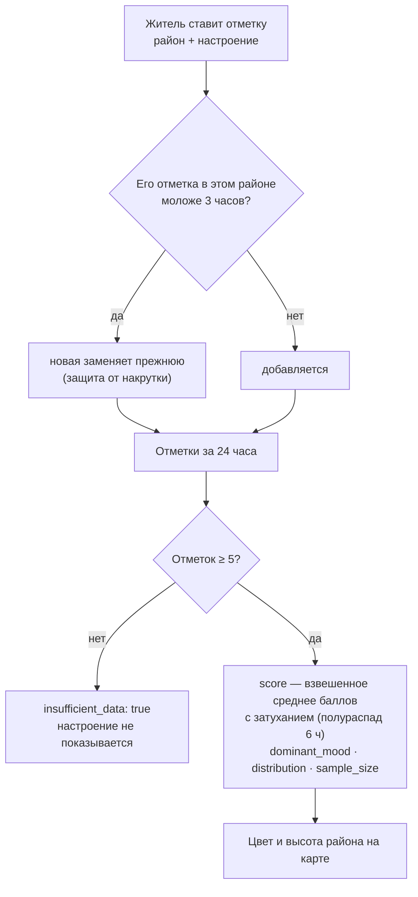
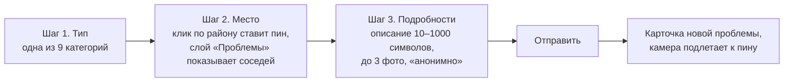
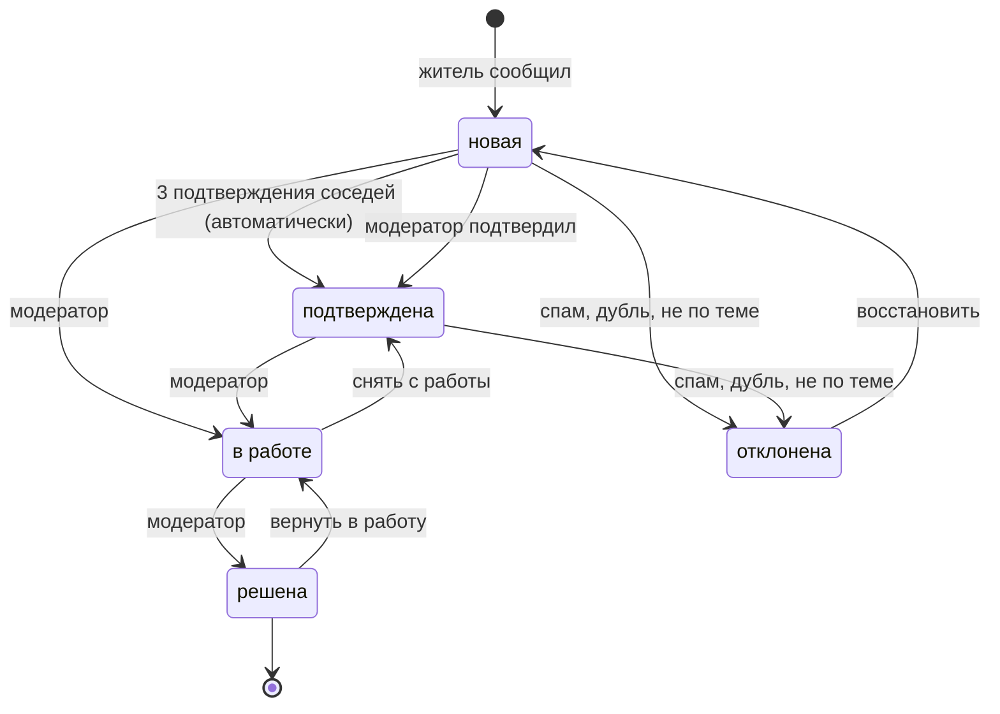
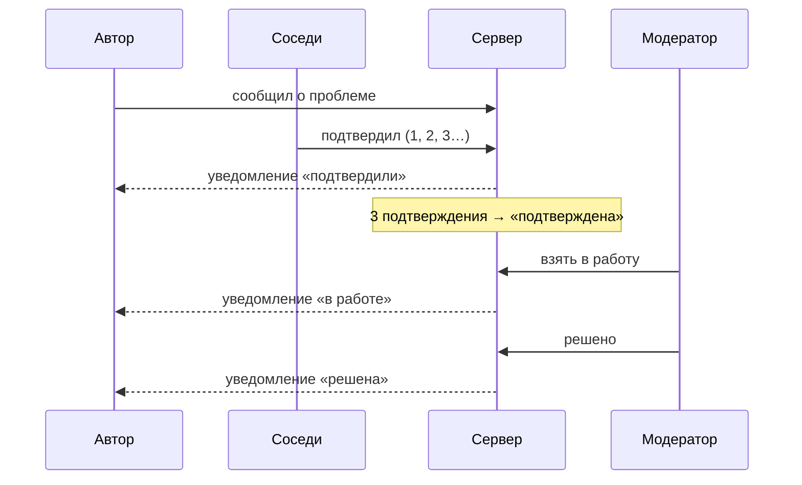

# 8. Настроение, проблемы, статистика

## Настроение района

Житель выбирает одно из семи настроений, у каждого свой балл:

| Код | Подпись | Балл |
|---|---|---|
| `excellent` | Отлично | +2 |
| `good` | Хорошо | +1 |
| `normal` | Нормально | 0 |
| `anxious` | Тревога | −1 |
| `bad` | Плохо | −1 |
| `angry` | Злость | −2 |
| `very_bad` | Очень плохо | −2 |

Из отметок за последние сутки складывается настроение района:

У каждого жителя в районе учитывается одна отметка: если он отметился повторно в течение трёх часов, новая
отметка заменяет старую. Так настроение нельзя накрутить.

Настроение района считается как среднее баллов за последние 24 часа, но свежие отметки весят больше: вес
отметки уменьшается вдвое каждые шесть часов. Кроме среднего (`score`, от −2 до +2) API отдаёт самое частое
настроение, доли всех настроений и число отметок.

Если отметок меньше пяти, настроение района не показывается: API возвращает `insufficient_data: true` без
распределения. Отдельные отметки наружу не отдаются никогда. На карте можно выбрать период: день, неделя или
месяц.

Отметка ставится в окне выбора настроения. Сначала выбирается район (заранее подставлен открытый район или «мой
район» из профиля), потом настроение. После отметки район ненадолго подсвечивается на карте.

## Сообщение о проблеме

Категорий девять: мусор, пробки, плохие дороги, освещение, шум, пьянство, общественный транспорт, состояние
парков и «другое».

На втором шаге карта переключается на слой «Проблемы». Житель видит, о чём уже сообщили рядом, и может
подтвердить существующую проблему, а не заводить дубль.

Перед отправкой фото пересохраняются прямо в браузере (в JPEG, не больше 1600 px по длинной стороне). Геометка и
модель телефона при этом теряются и с устройства не уходят. Сервер всё равно ещё раз удалит EXIF. Район
проблемы определяет сервер по точке, и если точка оказалась за пределами города, сообщение не примется.

## Что происходит с проблемой дальше

| Статус | Цвет метки | Кто видит |
|---|---|---|
| новая (`new`) | синий | все |
| подтверждена (`confirmed`) | янтарный | все |
| в работе (`in_progress`) | фиолетовый | все |
| решена (`resolved`) | зелёный | все |
| отклонена (`rejected`) | серый | только автор; на карте и в статистике её нет |

Статус меняет только модератор, кроме одного случая: после трёх подтверждений от разных жителей новая проблема
сама становится подтверждённой. Какие переходы разрешены, записано в `MODERATOR_TRANSITIONS`
(`shared/config/problemStatuses.js`). Бэкенд будет проверять то же самое и на любой другой переход ответит
ошибкой 409.

Свою проблему автор подтвердить не может. Своё подтверждение житель может снять, пока проблема новая.

Пока город не взялся за проблему (статусы «новая», «подтверждена» или «отклонена»), автор может отозвать
сообщение, и оно удаляется полностью. Проблема в работе или решённая уже стала частью истории района: её можно
только убрать из списка «Мои сообщения», на карте она останется.

Если проблему отклонили как дубль, в её карточке есть ссылка на исходную, чтобы автор мог подтвердить её.
Каждая смена статуса записывается в историю (`problem_status_changes`), историю видно в карточке проблемы.

## Уведомления

Уведомления видит только сам пользователь, они собраны под колокольчиком в шапке. Сайт проверяет их раз в
20 секунд и сразу, когда пользователь возвращается на вкладку. Если модератор подтвердил проблему вручную,
вернул её на шаг назад или восстановил, уведомление не приходит.

## Модерация

| Раздел | Адрес | Что там |
|---|---|---|
| Очередь | `/moderation` | сводка, фильтры по статусу, району и категории, кнопки только для разрешённых переходов |
| Карта | `/moderation/map` | та же 3D-карта с метками всех статусов; клик открывает карточку с действиями |
| Город | `/moderation/city` | районы по числу открытых проблем; проблема старше 14 дней выделена |
| Обращения | `/moderation/support` | письма жителей в поддержку; почта для ответа видна только здесь |
| Настройки | `/moderation/settings` | профиль, пароль, язык, тема |

Отклоняя проблему, модератор указывает причину: спам, дубль (с номером исходной проблемы) или «не городская
проблема».

При отправке можно поставить галочку «Опубликовать анонимно». Тогда жители видят вместо ника «Анонимный
житель», а модератор и сам автор видят настоящего автора.

## Статистика района

Карточка района показывает за выбранный период (день, неделя, месяц):

- настроение и доли всех семи настроений;
- проблемы по статусам и по категориям;
- график настроения, числа отметок и новых проблем;
- место района среди районов с достаточным числом отметок, отличие от среднего по городу, тренд и площадь района.

| Период | Точки на графике |
|---|---|
| день | 8 точек по три часа |
| неделя | 7 дней |
| месяц | 30 дней |
| год | 12 месяцев |
| все годы | каждый месяц с момента подключения города |

Порог в пять отметок действует и на отдельные точки графика. Если в каком-то интервале отметок меньше пяти,
настроения в этой точке нет, и линия графика прерывается.

## Статистика города

Дашборд открывается по адресу `/map/:city/stats?period=month|year|all`. В нём настроение города (среднее по
районам с учётом числа отметок), тренд, график, сообщения о проблемах за период по статусам и категориям и
таблица районов.

Районы на карте окрашиваются выбранным показателем. Для настроения используется обычная шкала настроения. Для
проблем та же шкала перевёрнута и считается относительно других районов: у района с наименьшим числом
сообщений «лучший» цвет. Высота плит показывает тот же показатель (см.
[раздел 5](05-map-3d.md#цвет-и-высота-районов)).

---

Назад: [7. Геоданные](07-geodata-pipeline.md) · [Оглавление](README.md) · Дальше: [9. Данные и API](09-data-and-api.md)
