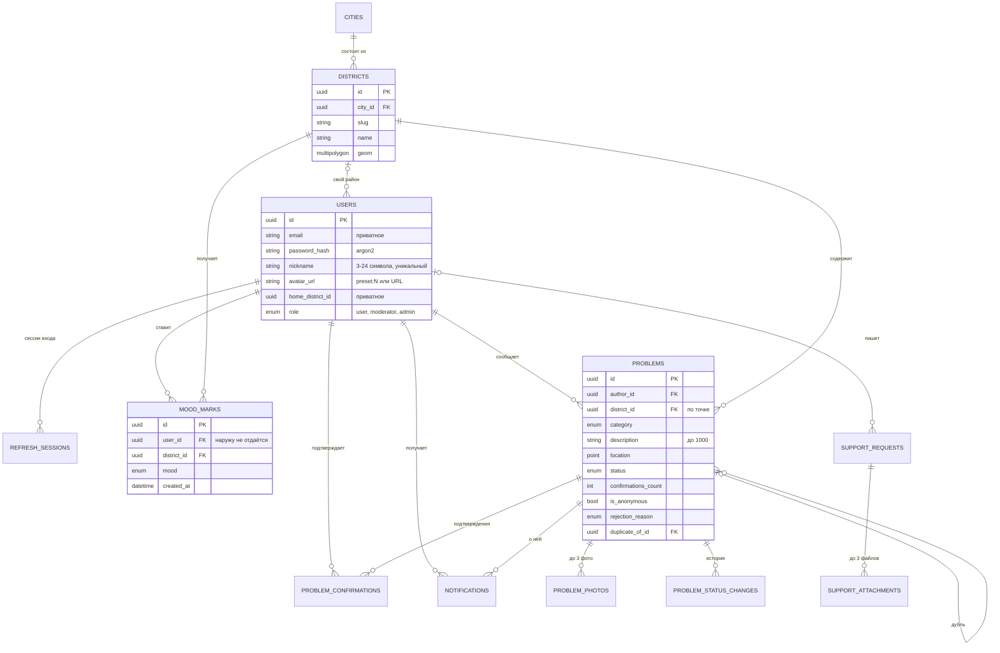
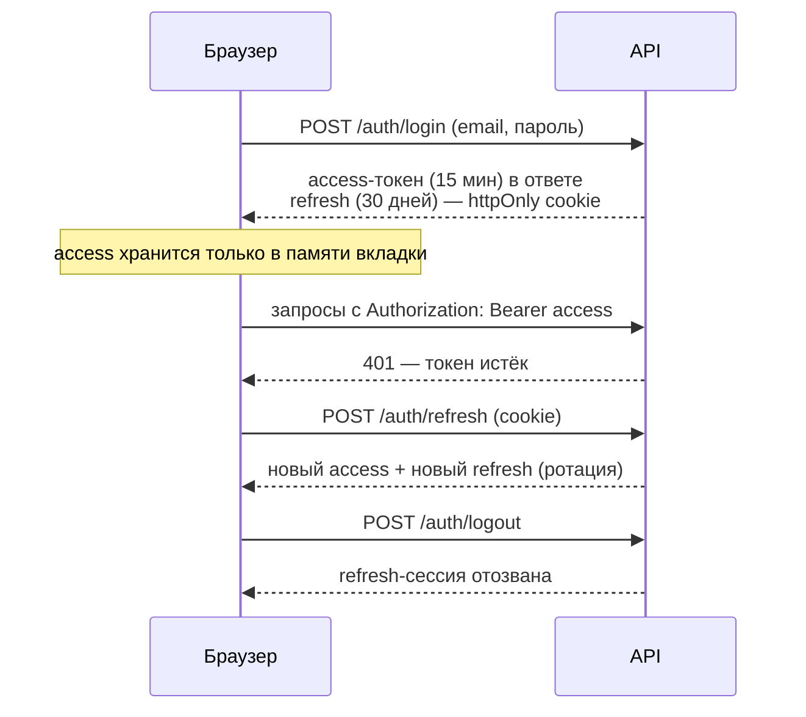

# 9. Данные и API

База данных пока не выбрана, это решение за владельцем проекта. Поэтому ниже описана логическая модель, без
привязки к конкретной СУБД. Все `id` — UUID, все даты хранятся в UTC с часовым поясом, геометрия — в WGS 84
(EPSG:4326).

## Модель данных



| Таблица | Для чего | Что важно |
|---|---|---|
| `users` | аккаунты | email и «мой район» видит только сам пользователь |
| `refresh_sessions` | обновление и отзыв токенов входа | хранится только хеш токена |
| `cities`, `districts` | города и районы | у полигона района пространственный индекс |
| `mood_marks` | отметки настроения | наружу отдаются только итоги по районам |
| `problems` | проблемы | район определяет сервер по точке |
| `problem_photos` | фото проблем | не больше трёх на проблему, без EXIF |
| `problem_confirmations` | подтверждения | один житель может подтвердить проблему один раз |
| `problem_status_changes` | история статусов | кто и когда сменил статус |
| `notifications` | уведомления | видит только получатель |
| `support_requests`, `support_attachments` | обращения в поддержку | почту для ответа видит только модератор |

## Коды

Главный список кодов будет лежать в `backend/app/models/enums.py`. Фронтенд повторяет их в
`frontend/src/shared/config/` вместе с подписями, цветами и иконками. Коды на фронте и бэке обязаны совпадать.

| Что | Коды |
|---|---|
| настроение (`Mood`) | `excellent`, `good`, `normal`, `anxious`, `bad`, `angry`, `very_bad` |
| категория проблемы (`ProblemCategory`) | `garbage`, `traffic`, `roads`, `lighting`, `noise`, `drunkenness`, `public_transport`, `parks`, `other` |
| статус проблемы (`ProblemStatus`) | `new`, `confirmed`, `in_progress`, `resolved`, отдельно `rejected` |
| причина отклонения (`RejectionReason`) | `spam`, `duplicate`, `offtopic` |
| роль (`UserRole`) | `user`, `moderator`, `admin` |
| период (`StatsPeriod`) | на карте `day`, `week`, `month`; на дашборде `month`, `year`, `all` |
| тема обращения (`SupportTopic`) | `account`, `map`, `mood`, `problems`, `security`, `technical`, `other` |
| статус обращения (`SupportRequestStatus`) | `new`, `in_progress`, `answered`, `closed` |
| состояние сервиса (`ServiceState`) | `operational`, `degraded`, `down` |

## API

Все адреса начинаются с `/api/v1`, данные передаются в JSON. Ошибки приходят в одном формате:

```json
{ "detail": { "code": "nickname_taken", "message": "…" } }
```

Язык ответа определяется по заголовку `Accept-Language` (`ru`, `kk`, `en` или `de`). На этом языке приходят
названия городов и районов, подписи и тексты ошибок. То, что написали сами жители, не переводится.

### Вход и профиль

| Метод | Адрес | Кому | Что делает |
|---|---|---|---|
| POST | `/auth/register` | всем | регистрация: email, пароль, ник, аватар, «мой район» |
| POST | `/auth/login` | всем | вход: access-токен в ответе, refresh-токен в httpOnly-cookie |
| POST | `/auth/refresh` | по cookie | выдать новую пару токенов |
| POST | `/auth/logout` | вошедшим | выйти и отозвать сессию |
| GET, PATCH | `/users/me` | вошедшим | свой профиль с email; изменить ник, аватар, район |
| PUT | `/users/me/avatar` | вошедшим | загрузить своё фото (до 10 МБ, EXIF удаляется) |
| POST | `/users/me/password` | вошедшим | сменить пароль; остальные сессии при этом отзываются |
| DELETE | `/users/me` | вошедшим | удалить аккаунт, нужен пароль |
| GET | `/users/me/problems` | вошедшим | мои сообщения с историей статусов |
| GET, POST, DELETE | `/users/me/notifications…` | вошедшим | уведомления: получить, отметить прочитанными, стереть |
| GET | `/users/{nickname}` | всем | публичный профиль: только ник и аватар |

### Город, районы, настроение

| Метод | Адрес | Кому | Что делает |
|---|---|---|---|
| GET | `/cities` | всем | список городов, Костанай первым |
| GET | `/cities/{slug}` | всем | город, районы, вода |
| GET | `/cities/{slug}/moods?period=` | всем | настроение всех районов для раскраски карты |
| GET | `/cities/{slug}/stats?period=` | всем | всё для дашборда города одним запросом |
| POST | `/districts/{id}/mood` | вошедшим | поставить отметку настроения |
| GET | `/districts/{id}/stats?period=` | всем | статистика района |

### Проблемы

| Метод | Адрес | Кому | Что делает |
|---|---|---|---|
| GET | `/problems?city=&district=&category=&status=&bbox=` | всем | метки для карты; без `status` — нерешённые и свежие за 30 дней |
| POST | `/problems` | вошедшим | создать: категория, точка, описание, до трёх фото, анонимно или нет |
| GET | `/problems/{id}` | всем | карточка проблемы с историей статусов |
| POST, DELETE | `/problems/{id}/confirm` | вошедшим | подтвердить или снять подтверждение |
| DELETE | `/problems/{id}` | автору | отозвать своё сообщение |
| PATCH | `/problems/{id}/status` | модератору | сменить статус; при отклонении указать причину |

### Модерация и поддержка

| Метод | Адрес | Кому | Что делает |
|---|---|---|---|
| GET | `/moderation/problems?status=&district=&category=&sort=` | модератору | очередь, до 100 проблем |
| GET | `/moderation/summary` | модератору | сводка по статусам и районам |
| GET, PATCH | `/moderation/support-requests…` | модератору | обращения и смена их статуса |
| POST | `/support/requests` | всем | написать в поддержку, до трёх файлов |
| GET | `/status` | всем | состояние сайта, карты, входа и поддержки |

Все поля и коды ошибок расписаны в [ARCHITECTURE.md, раздел 7](../../ARCHITECTURE.md#7-api-apiv1).

## Как живут токены входа



---

Назад: [8. Настроение, проблемы, статистика](08-mood-problems-stats.md) · [Оглавление](README.md) · Дальше: [10. Приватность и безопасность](10-privacy-security.md)
