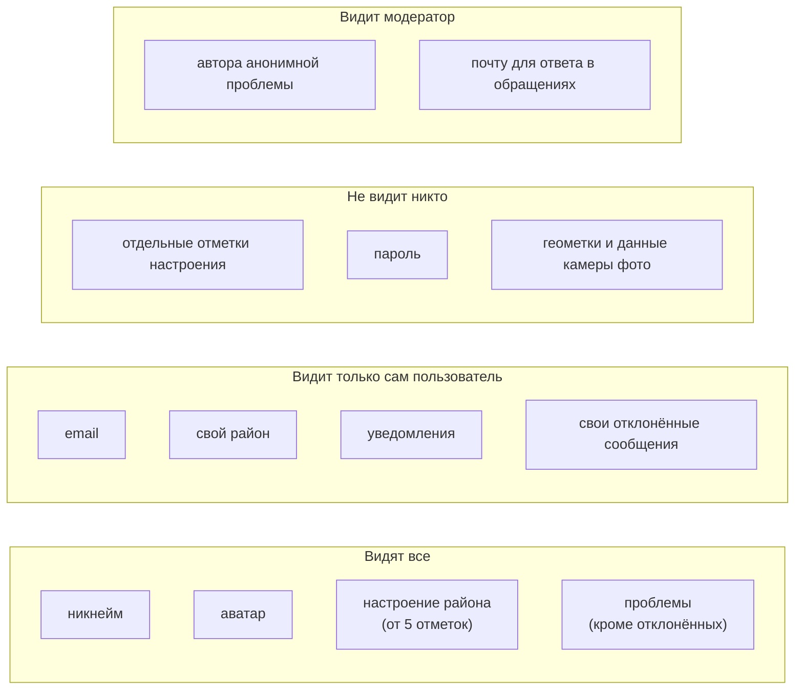
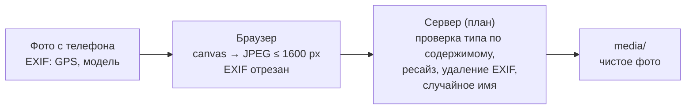

# 10. Приватность и безопасность

VibeRay показывает другим людям как можно меньше данных о пользователе. Ниже описано, что именно видно и как
защищены пароли, фото и вход.

## Кто что видит

Основных правил четыре.

1. Другим пользователям видны только `nickname` и `avatar_url` (схема `UserPublic`). Email, сессии и даты входа
   отдаются только самому пользователю через `/users/me`.
2. Отдельные отметки настроения наружу не отдаются никогда, только итог по району, и то если отметок не меньше
   пяти.
3. У всех загруженных фото удаляются EXIF-данные, в которых бывают координаты и модель телефона. Первый раз это
   делает браузер перед отправкой, второй раз — сервер.
4. Пароли хранятся только в виде хеша argon2. Секреты лежат в `.env`, а `.env` не попадает в репозиторий.

## Фото

Принимаются JPEG, PNG и WebP до 10 МБ, в обращения в поддержку можно приложить ещё и PDF. Тип файла сервер
проверяет по содержимому, а не по расширению, и сохраняет файл под случайным именем.

## Пароли

При регистрации пароль вводится дважды, а его надёжность показывается прямо во время ввода. Обязательно, чтобы
пароль был не короче восьми символов, не входил в список самых частых (123456, qwerty, йцукен и подобные) и не
содержал части email или ника. Кроме того, должно выполняться хотя бы одно из дополнительных условий: есть
строчные и заглавные буквы, цифра, спецсимвол или длина от 12 символов. Такой пароль считается «средним», слабее
сайт не примет.

Эти правила одинаковы во фронтенде (`shared/lib/passwordStrength.js`) и на бэкенде. На бэкенде ещё планируется
проверять пароль по базе утёкших паролей; наружу при этом уходят только первые пять символов его хеша.

## Токены и сессии

Access-токен (JWT) живёт 15 минут. Он хранится только в памяти вкладки и передаётся в заголовке
`Authorization: Bearer`. Refresh-токен живёт 30 дней и лежит в cookie с флагами httpOnly, Secure и
SameSite=Lax; в базе хранится только его хеш. При каждом обновлении выдаётся новый refresh-токен, а старый
перестаёт работать. Смена пароля отзывает все остальные сессии пользователя.

CORS разрешён только для адреса фронтенда. Число отметок и новых проблем от одного пользователя ограничено по
частоте.

## Модератор и анонимность

Если проблема отправлена анонимно, жители видят «Анонимный житель», а модератор и сам автор видят настоящего
автора. Отклонённое сообщение видит только его автор, остальным запрос `GET /problems/{id}` вернёт 404. Почту
для ответа из обращения в поддержку модератор видит только в разделе «Обращения».

---

Назад: [9. Данные и API](09-data-and-api.md) · [Оглавление](README.md) · Дальше: [11. Словарь](11-glossary.md)
